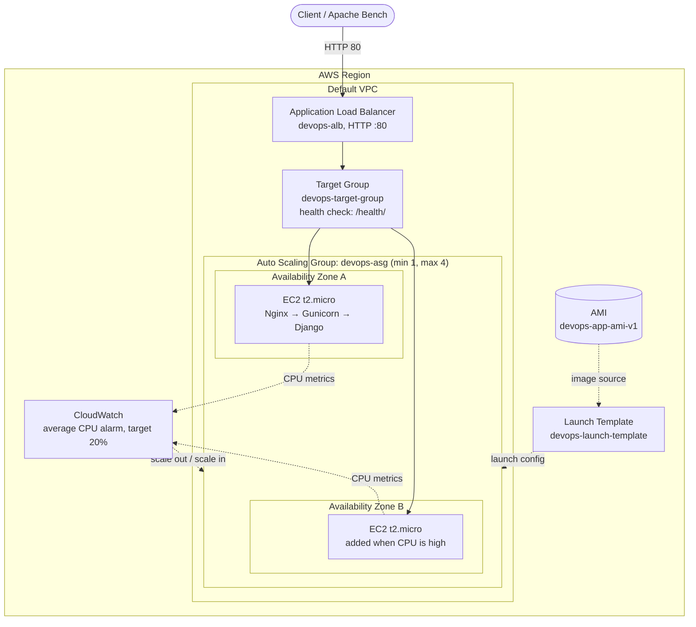
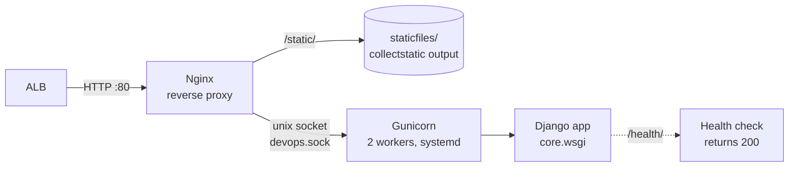
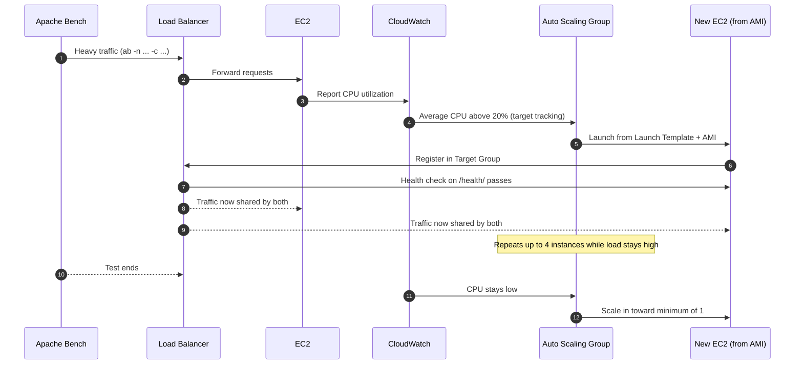

# Auto-Scaling Django on AWS

**EC2 → AMI → Launch Template → ALB → Auto Scaling Group → Load Test**

A hands-on DevOps lab: deploy a Django app on EC2 production-style (Gunicorn + Nginx), turn that server into a reusable AMI, and put it behind an Application Load Balancer and an Auto Scaling Group that grows from 1 to 4 instances when average CPU passes 20%. Apache Bench generates the traffic, and the scaling is watched live in CloudWatch and the ASG Activity tab.


---

## Table of contents

1. [What this lab shows](#what-this-lab-shows)
2. [Architecture](#architecture)
3. [How scaling works](#how-scaling-works)
4. [Tech stack](#tech-stack)
5. [Repository structure](#repository-structure)
6. [Step-by-step build](#step-by-step-build)
7. [Configuration reference](#configuration-reference)
8. [Load test and results](#load-test-and-results)
9. [Design decisions](#design-decisions)
10. [Troubleshooting](#troubleshooting)
11. [Security notes](#security-notes)
12. [Cost and cleanup](#cost-and-cleanup)
13. [Credits](#credits)

---

## What this lab shows

- A single server is a single point of failure. Several servers behind a load balancer are not.
- Manual setup does not scale. An **AMI + Launch Template** makes every new server an identical copy.
- **Load balancer + Auto Scaling** together make the system elastic: capacity follows demand without anyone adding servers by hand.

This is the same pattern used for traffic spikes such as sale days, viral posts and registration rushes. The concept applies to Azure and GCP as well.

---

## Architecture



### What runs on each instance



### How the golden image is built

```mermaid
flowchart LR
    A["1. Launch EC2 #1<br/>golden instance"] --> B["2. Deploy Django<br/>venv, migrate, collectstatic"]
    B --> C["3. Gunicorn systemd<br/>+ Nginx"]
    C --> D["4. Test via public IP"]
    D --> E["5. Create AMI"]
    E --> F["6. Launch Template"]
    F --> G["7. Target Group + ALB"]
    G --> H["8. Auto Scaling Group<br/>min 1 / max 4"]
    H --> I["9. CPU 20% scaling policy"]
    I --> J["10. Load test + watch"]
    J --> K["11. Cleanup"]
```



---

## How scaling works



---

## Tech stack

| Layer | Tool |
|---|---|
| Cloud | AWS (EC2, AMI, Launch Template, ALB, Target Group, Auto Scaling, CloudWatch) |
| OS | Ubuntu Server 22.04 LTS |
| Instance type | t2.micro (Free Tier eligible) |
| App | Django (sample app from the lab) |
| App server | Gunicorn, managed by systemd |
| Web server | Nginx (reverse proxy and static files) |
| Load testing | Apache Bench (`apache2-utils`) |

---

## Repository structure

```text
devops-asg-lab/
├── README.md
├── .gitignore
├── configs/
│   ├── gunicorn.service          # systemd unit for Gunicorn
│   └── nginx-devops-app.conf     # Nginx site config
├── scripts/
│   ├── load-test.sh              # Apache Bench wrapper
│   └── watch-asg.sh              # live view of ASG instances (AWS CLI)
└── docs/
    └── screenshots/              # add your own proof screenshots here
```

---

## Step-by-step build

### Part 1. Launch the golden instance

| Setting | Value |
|---|---|
| Name | `devops-golden-instance` |
| AMI | Ubuntu Server 22.04 LTS |
| Type | t2.micro |
| Key pair | new key `devops-key` (keep the `.pem` private) |
| Storage | 8 GB |

Inbound security group rules:

| Type | Port | Source |
|---|---|---|
| SSH | 22 | My IP |
| HTTP | 80 | 0.0.0.0/0 |
| Custom TCP | 8000 | 0.0.0.0/0 (**temporary**, removed in Part 3) |

Checkpoint: instance is *Running* with 2/2 status checks passed.

### Part 2. Deploy the app

```bash
chmod 400 devops-key.pem
ssh -i "devops-key.pem" ubuntu@<EC2_PUBLIC_IP>
```

```bash
sudo apt update && sudo apt upgrade -y
sudo apt install python3-pip python3-venv nginx git -y

cd ~
git clone https://github.com/HaseebAhmad24-collab/devops-scaling-app
cd devops-scaling-app

python3 -m venv venv
source venv/bin/activate
pip install -r requirements.txt
python manage.py migrate
python manage.py collectstatic --noinput
python manage.py runserver 0.0.0.0:8000   # quick test only, stop with CTRL+C
```

Open `http://<EC2_PUBLIC_IP>:8000`. The page should show the real EC2 instance ID.

### Part 3. Gunicorn (systemd) and Nginx

Copy [`configs/gunicorn.service`](configs/gunicorn.service) to `/etc/systemd/system/gunicorn.service`, then:

```bash
sudo systemctl daemon-reload
sudo systemctl start gunicorn
sudo systemctl enable gunicorn
sudo systemctl status gunicorn
```

Copy [`configs/nginx-devops-app.conf`](configs/nginx-devops-app.conf) to `/etc/nginx/sites-available/devops-app`, then:

```bash
sudo ln -s /etc/nginx/sites-available/devops-app /etc/nginx/sites-enabled/
sudo rm /etc/nginx/sites-enabled/default
sudo nginx -t
sudo systemctl restart nginx

# let Nginx reach the socket inside the home folder
sudo usermod -a -G ubuntu www-data
chmod 710 /home/ubuntu
```

Checkpoint: `http://<EC2_PUBLIC_IP>` works on port 80. **Now delete the temporary port 8000 rule** from the security group.

### Part 4. Create the AMI

EC2 → select the golden instance → **Actions → Image and templates → Create image**

| Setting | Value |
|---|---|
| Image name | `devops-app-ami-v1` |
| Description | Django app with Gunicorn + Nginx configured |
| No reboot | leave unchecked (clean image) |

Wait until the AMI status is **Available**.

### Part 5. Launch Template

| Setting | Value |
|---|---|
| Name | `devops-launch-template` |
| AMI | My AMIs → `devops-app-ami-v1` |
| Instance type | t2.micro |
| Key pair | `devops-key` |
| Security group | the instance security group (ports 22 and 80) |

### Part 6. Target Group and Load Balancer

**Target Group**

| Setting | Value |
|---|---|
| Target type | Instances |
| Name | `devops-target-group` |
| Protocol / port | HTTP / 80 |
| VPC | Default |
| Health check path | `/health/` |

Check `urls.py` before choosing the path. Here `dashboard.urls` is included at the root (`path('', include('dashboard.urls'))`) and the route is `path('health/', ...)`, so the real URL is `/health/`, not `/dashboard/health/`. A wrong path makes every target fail with 404 and the ASG replaces healthy instances in a loop.

**Application Load Balancer**

| Setting | Value |
|---|---|
| Name | `devops-alb` |
| Scheme | Internet-facing |
| VPC | Default |
| Availability Zones | at least 2 subnets |
| Security group | new, allow HTTP 80 from anywhere |
| Listener | HTTP:80 → forward to `devops-target-group` |

Wait for State = **Active** and copy the DNS name.

### Part 7. Auto Scaling Group

| Setting | Value |
|---|---|
| Name | `devops-asg` |
| Launch template | `devops-launch-template` |
| Subnets | same as the ALB |
| Load balancing | attach existing target group, turn ON ELB health checks |
| Desired / min / max | 1 / 1 / 4 |
| Scaling policy | Target tracking, name `cpu-target-tracking` |
| Metric / target | Average CPU utilization / 20 |
| Instance warmup | 60 seconds |

### Part 8. Verify before load testing

1. The ASG launched one instance.
2. Target Group shows it as **healthy**.
3. `http://<ALB_DNS_NAME>` shows the dashboard with the new instance ID.

---

## Configuration reference

| Component | Setting | Value |
|---|---|---|
| ASG | Min / Desired / Max | 1 / 1 / 4 |
| Scaling policy | Type | Target tracking |
| Scaling policy | Metric and target | Average CPU, 20% |
| Scaling policy | Instance warmup | 60 s |
| Gunicorn | Workers | 2 |
| Gunicorn | Restart policy | `Restart=always`, `RestartSec=5` |
| Target Group | Health check | `GET /health/` |
| ALB | Listener | HTTP:80 |

---

## Load test and results

Run from a second machine, ideally an EC2 instance in the same region:

```bash
sudo apt install apache2-utils -y

# recommended for the demo
./scripts/load-test.sh <ALB_DNS_NAME> 200000 200
# same as: ab -n 200000 -c 200 http://<ALB_DNS_NAME>/
```

`-n` is the total number of requests and `-c` is how many run in parallel. The lab text also mentions a 10,000,000 request run (`ab -n 10000000 -c 500 ...`). That can take hours and may go past Free Tier limits, so only run it if your assignment requires it.

Watch scaling in a second terminal:

```bash
./scripts/watch-asg.sh devops-asg
```

Or use the console: **EC2 → Auto Scaling Groups → devops-asg → Activity**, **EC2 → Instances**, and **CloudWatch → Metrics → EC2 → Per-Instance Metrics → CPUUtilization**.

### My results

> Fill this section with your own numbers and screenshots after your run. Do not copy values from anywhere else.

| Item | My run |
|---|---|
| Requests (`-n`) | |
| Concurrency (`-c`) | |
| Peak average CPU | |
| Max instances reached | |
| Time to first scale-out | |
| Scaled back in to 1? | |

Screenshots to add in `docs/screenshots/`:

| File | What it should show |
|---|---|
| `01-target-group-healthy.png` | Target Group with healthy targets |
| `02-alb-dashboard.png` | App open through the ALB DNS name |
| `03-asg-activity-scale-out.png` | ASG Activity tab with launch events |
| `04-cloudwatch-cpu.png` | CloudWatch CPU graph with the spike |
| `05-instances-running.png` | Multiple instances running |

When the files exist, embed them like this:

```markdown

```

---

## Design decisions

| Decision | Why |
|---|---|
| 2 Gunicorn workers, not 3 | The usual `(2 × cores) + 1` gives 3 on one vCPU, but a t2.micro has 1 GB RAM shared with Nginx and the OS. Two workers avoids memory pressure under load. |
| `Restart=always` in systemd | If Gunicorn crashes, it comes back in 5 seconds instead of failing health checks and hiding the real cause. |
| Unix socket between Nginx and Gunicorn | Simple, fast and not exposed on the network. |
| Port 8000 closed after testing | Nginx already proxies everything on port 80, so an open 8000 only adds attack surface. |
| Health check at `/health/` | Matches the real URL in `urls.py`. A wrong path causes an endless replace loop. |
| ELB health checks enabled on the ASG | Lets the ASG replace instances that the load balancer marks unhealthy. |
| Reboot allowed when creating the AMI | Gives a consistent filesystem state in the image. |

---

## Troubleshooting

| Problem | Likely cause | Fix |
|---|---|---|
| `ERR_ADDRESS_INVALID` on `0.0.0.0:8000` | Browsers cannot open `0.0.0.0` | Use `127.0.0.1:8000` or the EC2 public IP |
| 502 Bad Gateway | Gunicorn not running, or socket path mismatch | `sudo systemctl status gunicorn`, check the socket path matches the Nginx config |
| Site not reachable | Missing security group rule | Add the inbound rule for port 80 |
| Target shows unhealthy | Wrong health check path or Nginx not serving it | `curl localhost/health/` on the instance should return 200 |
| ASG not scaling | Target too high or load too light | Confirm target is 20%, raise `-c` in Apache Bench |
| Permission denied (Nginx to socket) | `www-data` cannot enter the home folder | Re-run the `usermod` and `chmod 710 /home/ubuntu` commands from Part 3 |
| CSS/JS not loading | Nginx `/static/` alias does not match `STATIC_ROOT` | Point the alias to `.../staticfiles/`, the collectstatic output |
| Gunicorn silently not responding | Worker crashed or stuck | `sudo journalctl -u gunicorn -f` |
| Errors with unclear reason | Need raw Nginx logs | `sudo tail -f /var/log/nginx/error.log` and `access.log` |

---

## Security notes

- **Never commit your `.pem` key.** The included `.gitignore` blocks `*.pem`, `.env` and similar files.
- SSH (port 22) is limited to **My IP**, not the whole internet.
- Port 8000 is only open during the first test and then deleted.
- Optional hardening: change the instance security group's HTTP source from `0.0.0.0/0` to the **ALB security group**, so traffic can only arrive through the load balancer.
- This lab uses plain HTTP. In production, add an HTTPS:443 listener with a free certificate from AWS Certificate Manager and redirect HTTP to HTTPS.

---

## Cost and cleanup

- Free Tier gives about 750 EC2 hours **per month for the whole account**, not per instance. Four instances use hours four times as fast.
- The ALB is covered by the Free Tier only for the first 12 months and with limited hours.
- t2.micro is burstable. In very long, heavy tests its CPU credits can run out and CPU gets throttled, so keep the test short.

**Delete everything when you are done, in this order:**

1. Auto Scaling Group (terminates its instances and removes the scaling policy and alarms)
2. Load Balancer
3. Target Group
4. Launch Template
5. Deregister the AMI, then delete its snapshot
6. Terminate the original golden instance if it is still running
7. Security groups (only after everything above is gone)

---

